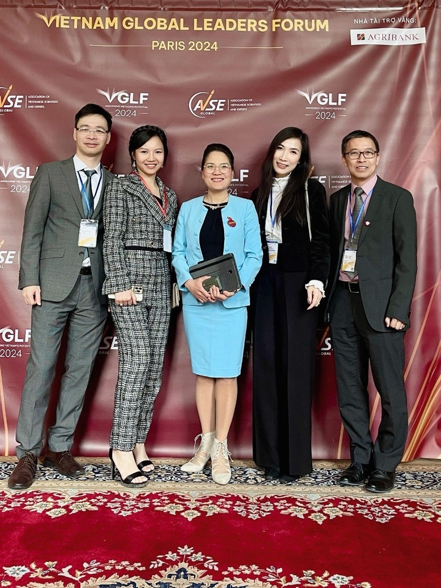

Ts. Lưu Vĩnh Toàn, Chủ tịch Hội Trí thức và Chuyên gia Việt Nam tại Thụy Sĩ (AVIES), có nhiều năm nghiên cứu và làm việc trong công nghệ tìm kiếm, xử lý dữ liệu và trí tuệ nhân tạo. Tại Diễn đàn người Việt có Tầm ảnh hưởng tại Paris 2024 (VGLF 2024), Ts Toàn đã có buỏi chia sẻ với báo VTC News. 

Từ mong muốn kết nối nguồn lực Việt trên toàn cầu, ông cùng các cộng sự phát triển VietSearch, công cụ hỗ trợ tìm kiếm chuyên gia trong nhiều lĩnh vực như AI, bán dẫn, vaccine và năng lượng xanh. Dù gặp khó khăn về nhân lực, kinh phí và hạ tầng, nhóm tiếp tục theo đuổi mục tiêu đưa các kết nối trở thành hành động thiết thực. Cùng với AVSE Global, nhóm cũng phát triển V-Space nhằm kết nối dự án, chuyên gia và nhà tài trợ hướng tới những sáng kiến phục vụ Việt Nam. Về trí tuệ nhân tạo, TS. Toàn cho rằng AI có thể hỗ trợ hiệu quả nhiều công việc nhưng không thể thay thế hoàn toàn con người. Ông khuyến nghị doanh nghiệp xác định rõ nhu cầu và dữ liệu trước khi ứng dụng công nghệ, đồng thời khuyến khích người trẻ nuôi dưỡng đam mê giải quyết vấn đề để đóng góp cho cộng đồng.

*Bài viết được biên tập từ thông tin VTC News công bố ngày 20/05/2024. Ảnh: TS. Lưu Vĩnh Toàn cùng đại diện AVIES tham gia Diễn đàn Người Việt có tầm ảnh hưởng 2024, nguồn VTC News.*

